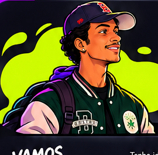

<div align="center">

# Vitor Melo — Developer Portfolio

### Backend Developer | APIs | Databases | Digital Products

**A personal portfolio built to showcase my development journey, technical skills, and real-world projects.**

[Live Website](https://vitormelo.dev) · [GitHub](https://github.com/VitorDutraMelo) · [LinkedIn](https://www.linkedin.com/in/vitordutramelo)


</div>

---

## About the Portfolio

This repository contains the source code for my personal developer portfolio, available at **[vitormelo.dev](https://vitormelo.dev)**.

The website highlights my work as a backend developer, my technical interests, and the digital products I am building.

It combines a custom illustrated visual identity with a responsive layout, interactive components, and a project showcase.

### Highlights

- Responsive design for desktop and mobile
- Custom illustrations and visual identity
- Interactive navigation
- Dynamic project cards
- Technology and skills showcase
- Personal journey dialog
- Direct WhatsApp contact
- GitHub, LinkedIn, and Instagram integration
- Downloadable CV
- Custom domain powered by GitHub Pages

---

## Visual Identity

The portfolio uses a distinctive visual language with dark backgrounds, expressive illustrations, and colorful accents.

### London Illustration


### About Me



---

## Featured Projects

### The Club

A social fitness platform focused on challenges, activity tracking, competition, rankings, and virtual rewards.

**Technologies:** Node.js, TypeScript, Express, PostgreSQL, Prisma

### PIKO

A virtual companion ecosystem designed around interaction, tasks, rewards, and a connected experience for families.

**Technologies:** C++, LVGL, Node.js, TypeScript, PostgreSQL

### TradePulse

A market-analysis platform focused on data processing, technical analysis, and informational trading signals.

**Technologies:** Python, Node.js, TypeScript, React

### LoyaltyQR

A digital loyalty platform focused on helping businesses manage customer relationships, rewards, and loyalty programs.

**Technologies:** Node.js, TypeScript, PostgreSQL

> Project screenshots will be added as the individual projects evolve.

---

## Technology Stack

| Area | Technologies |
|------|-------------|
| Markup | HTML5 |
| Styling | CSS3 |
| Interactivity | JavaScript |
| Version Control | Git and GitHub |
| Hosting | GitHub Pages |
| Domain | vitormelo.dev |

The portfolio is built without a frontend framework, keeping the implementation lightweight and straightforward to maintain.

---

## Project Structure

```text
personal-landing-page/
├── assets/
│   ├── character/
│   │   └── v2/
│   │       ├── vitor-hero.png
│   │       └── vitor-about.png
│   ├── london/
│   │   └── v2/
│   │       └── london-portfolio.png
│   ├── projects/
│   └── Vitor-Melo-Backend-Developer.pdf
├── index.html
├── styles.css
├── app.js
├── journey-content.js
├── CNAME
├── .gitignore
└── README.md
```

---

## Running Locally

Clone the repository:

```bash
git clone https://github.com/VitorDutraMelo/personal-landing-page.git
```

Navigate into the project:

```bash
cd personal-landing-page
```

Start a local HTTP server:

```bash
python -m http.server 5500
```

Then open:

**http://localhost:5500**

No dependency installation or build process is required.

---

## Contact

Interested in collaborating, discussing a project, or connecting professionally?

- **Website:** [vitormelo.dev](https://vitormelo.dev)
- **GitHub:** [VitorDutraMelo](https://github.com/VitorDutraMelo)
- **LinkedIn:** [Vitor Dutra Melo](https://www.linkedin.com/in/vitordutramelo)
- **Instagram:** [vitormelodev](https://instagram.com/vitormelodev)
- **WhatsApp:** [Get in touch](https://wa.me/447771223604)

---

<div align="center">

**Designed and developed by Vitor Melo**

[Back to top](#vitor-melo--developer-portfolio)

</div>
